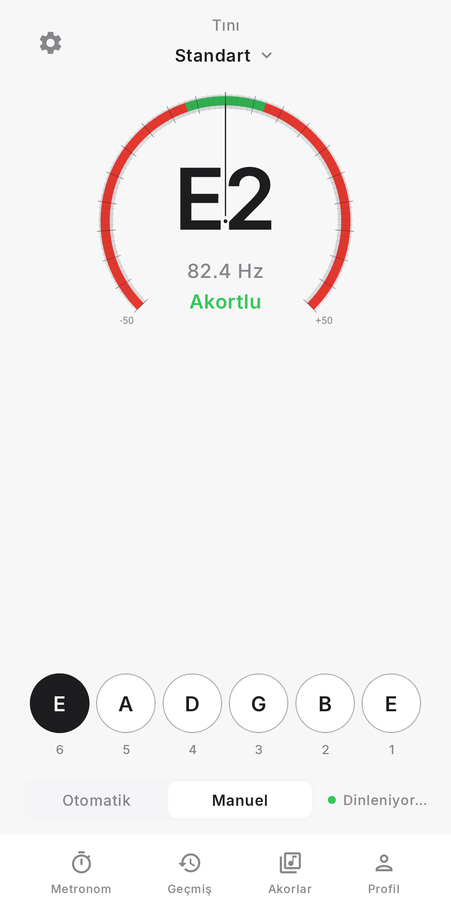
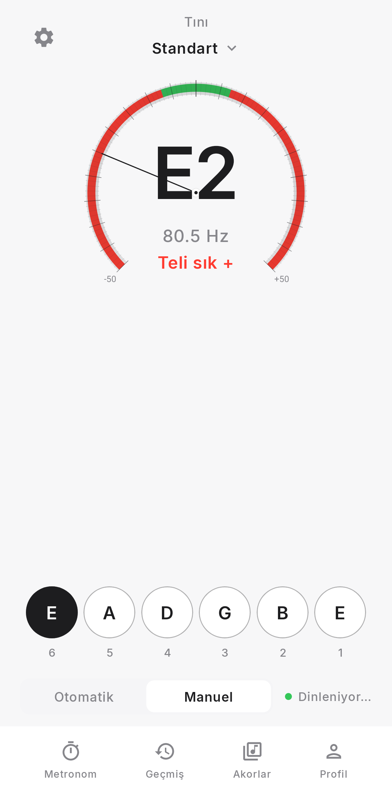
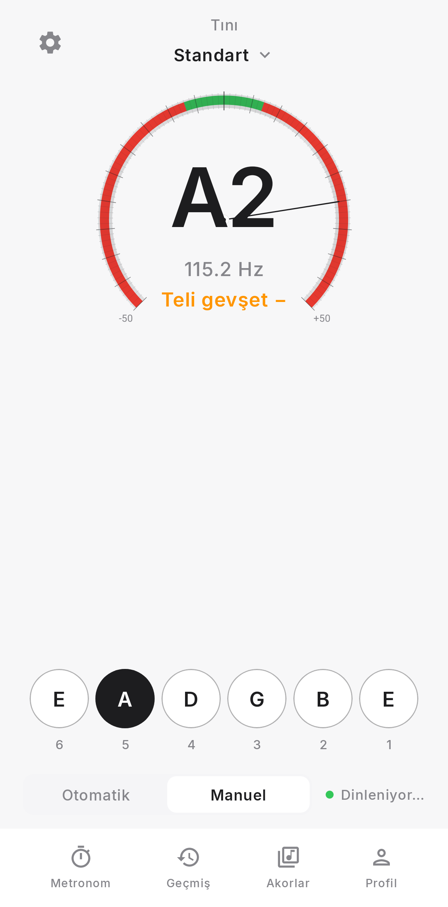
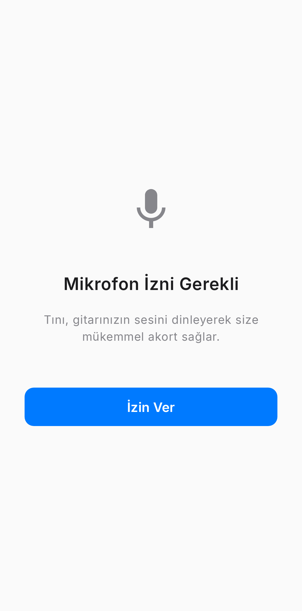
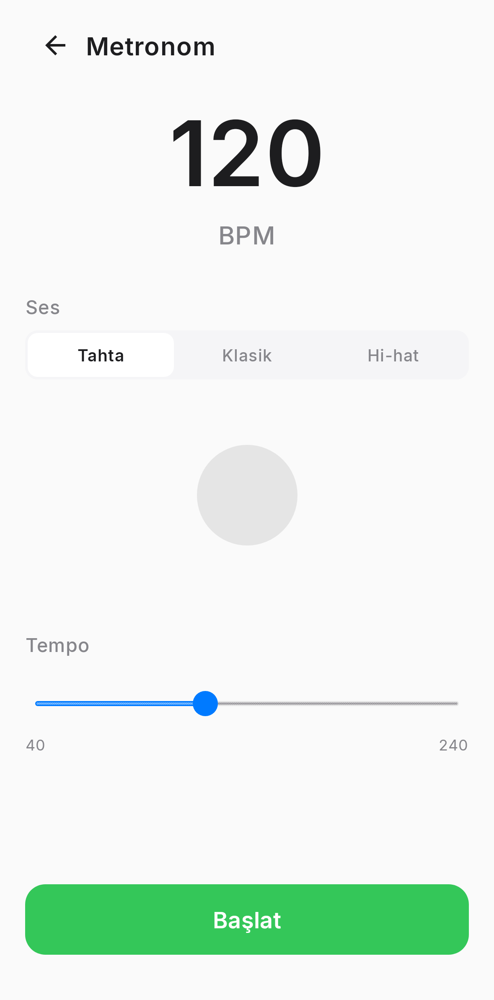
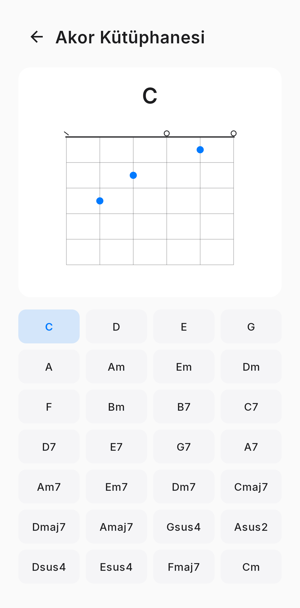
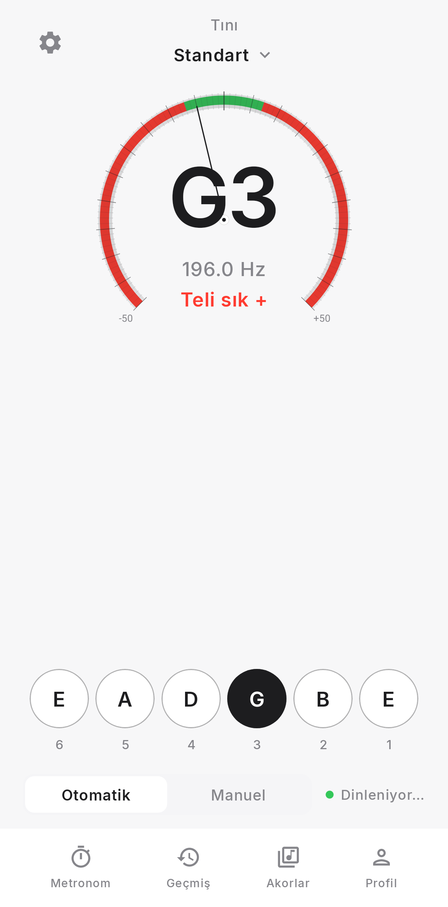

<div align="center">


# Tını

**Gitarınız için minimal ve hassas akort uygulaması**

[](https://github.com/EkremTezcanSaridag/Tini_app/actions/workflows/build.yml)
[](https://kotlinlang.org)
[-green.svg)](https://developer.android.com)
[](LICENSE)

</div>

---

## 📱 Ekran Görüntüleri

<table>
  <tr>
    <td></td>
    <td></td>
    <td></td>
    <td></td>
  </tr>
  <tr>
    <td align="center"><b>Akortlu (0 cent)</b></td>
    <td align="center"><b>Teli sık + (−25 cent)</b></td>
    <td align="center"><b>Teli gevşet − (+30 cent)</b></td>
    <td align="center"><b>Mikrofon İzni</b></td>
  </tr>
  <tr>
    <td></td>
    <td></td>
    <td></td>
    <td></td>
  </tr>
  <tr>
    <td align="center"><b>Metronom</b></td>
    <td align="center"><b>Akor Kütüphanesi</b></td>
    <td align="center"><b>Burgu + tel daireleri</b></td>
    <td></td>
  </tr>
</table>

---

## ✨ Özellikler

- **🎯 YIN Perde Algılama:** Yüksek hassasiyetli perde algılama algoritması ile profesyonel sonuçlar
- **🎸 Çoklu Akort Desteği:** 9 gitar + bas + ukulele akortları
  - **Gitar:** Standart, Drop D, Drop C, Yarım ton pes (Eb), Drop Db, Open G, Open D, DADGAD, Double Drop D
  - **Bas:** Standart (E A D G), Drop D, 5 Tel (B E A D G)
  - **Ukulele:** C (GCEA), D (ADF#B)
- **🎼 Metronom:** 40–240 BPM, profesyonel tahta/klasik/hi-hat sesleri (SoundPool, vurgulu 1. vuruş), görsel nabız
- **📜 Akort geçmişi:** Otomatik kayıt, son 100 oturum
- **🌓 Tema:** Açık (varsayılan), koyu, sistem
- **🎵 Akor kütüphanesi:** 30 yaygın akor, Canvas diyagramları
- **📊 Spektrum:** Gerçek zamanlı FFT görselleştirme
- **🔀 Çoklu tel:** FFT çok-tepe analizi ile eşzamanlı tel eşleştirme
- **💾 Profiller:** JSON kayıt ve paylaşım (Share intent)
- **📱 Widget:** Ana ekranda son akort durumu
- **✅ Hassas Akort:** ±5 cent toleransla tam akort göstergesi
- **🎚️ A4 Referans Ayarı:** 430-450 Hz arası özelleştirilebilir (varsayılan: 440 Hz)
- **🎭 Akıllı Modlar:**
  - **Otomatik:** Çaldığınız teli otomatik algılar
  - **Manuel:** İstediğiniz teli seçip akort edin
- **📳 Haptik Geri Bildirim:** Akort tamamlandığında titreşim
- **🎨 Minimal Arayüz:** Apple tarzı temiz ve modern tasarım
- **📊 Gerçek Zamanlı Gösterge:** 
  - Büyük not gösterimi (örn: E2, A2, D3)
  - Frekans (Hz) gösterimi
  - -50 ile +50 cent arası yatay cetvel
  - Renkli durum göstergesi (yeşil: akortlu, turuncu: pest, kırmızı: tiz)

---

## 🎵 "Cent" Nedir?

**Cent**, müzikte kullanılan logaritmik bir frekans ölçü birimidir. İki nota arasındaki mesafe 100 cent'tir.

- **0 cent:** Tam akortlu
- **Negatif değer (örn: -25 cent):** **Teli sık +** (tel pes — gerdirmeniz gerekir)
- **Pozitif değer (örn: +30 cent):** **Teli gevşet −** (tel tiz — gevşetmeniz gerekir)

Tını, **±5 cent** toleransla akordunuzu kontrol eder. Bu hassasiyet profesyonel müzisyenler için yeterlidir.

---

## 📥 Kurulum

### Yöntem 1: GitHub Actions (Önerilen)

1. [Actions sayfasına](https://github.com/EkremTezcanSaridag/Tini_app/actions) gidin
2. Son başarılı çalıştırmaya tıklayın
3. **Artifacts** bölümünden `Tini-apk` dosyasını indirin
4. ZIP'i açın ve `app-debug.apk` dosyasını telefonunuza yükleyin

### Yöntem 2: GitHub Releases

1. [Releases sayfasına](https://github.com/EkremTezcanSaridag/Tini_app/releases) gidin
2. En son sürümü (v2.1) indirin
3. APK dosyasını telefonunuza yükleyin

### ⚠️ Önemli Not: Eski Sürümlerden Güncelleme

**v2.1 öncesi kurulu bir sürümünüz varsa, uygulamayı önce kaldırmalısınız.** Nedeni: v2.1 ile birlikte imza anahtarı değiştirilmiştir (kararlı imzalar için). Eski sürümü kaldırmadan yeni sürümü yükleyemezsiniz.

```bash
# Eski sürümü kaldırın (Ayarlar > Uygulamalar > Tını > Kaldır)
# Ardından yeni APK'yı yükleyin
```

v2.1 ve sonraki sürümler aynı imza anahtarını kullanacağı için sorunsuz güncellenecektir.

---

## 🛠️ Kaynaktan Derleme

### Gereksinimler

- Android Studio Hedgehog | 2023.1.1 veya üzeri
- JDK 17
- Android SDK 34
- Gradle 8.2+

### Derleme Adımları

```bash
# Depoyu klonlayın
git clone https://github.com/EkremTezcanSaridag/Tini_app.git
cd Tini_app

# Debug APK oluşturun
./gradlew assembleDebug

# APK konumu: app/build/outputs/apk/debug/app-debug.apk
```

### Testler

```bash
# Tüm testleri çalıştırın (25 birim testi)
./gradlew test

# Test raporu: app/build/reports/tests/testDebugUnitTest/index.html
```

### Ekran Görüntüleri (Roborazzi)

```bash
# Ekran görüntülerini oluşturun (yerel olarak çalıştırın)
./gradlew recordRoborazziDebug

# Çıktılar: app/build/outputs/roborazzi/
```

**Not:** Ekran görüntüsü testleri CI'da `@Ignore` ile devre dışı bırakılmıştır (Roborazzi NATIVE grafik modu ekran gerektirir).

---

## 📂 Proje Yapısı

```
Tini_app/
├── app/
│   ├── src/main/
│   │   ├── java/com/tini/tuner/
│   │   │   ├── MainActivity.kt          # Ana Activity (izinler, yaşam döngüsü)
│   │   │   ├── TunerViewModel.kt        # Durum yönetimi ve iş mantığı
│   │   │   ├── TunerScreen.kt           # UI bileşenleri (Compose)
│   │   │   ├── AudioCapture.kt          # Mikrofon ses kaydı
│   │   │   ├── YinPitchDetector.kt      # YIN perde algılama algoritması
│   │   │   ├── TuningUtils.kt           # Akort yardımcı fonksiyonları
│   │   │   └── Models.kt                # Veri modelleri
│   │   └── res/
│   │       ├── drawable/                # Vektör grafikler (ikon katmanları)
│   │       ├── font/                    # Inter font ailesi
│   │       └── values/                  # Tema, renkler
│   ├── src/test/
│   │   └── java/com/tini/tuner/
│   │       ├── TunerScreenshotTest.kt   # Roborazzi UI testleri
│   │       ├── TuningUtilsTest.kt       # Akort mantık testleri
│   │       └── YinPitchDetectorTest.kt  # YIN algoritma testleri
│   ├── tini-debug.keystore              # Debug imza anahtarı (kararlı imzalar)
│   └── build.gradle.kts                 # Modül yapılandırması
├── docs/
│   ├── icon.png                         # Uygulama ikonu (README için)
│   └── screenshots/                     # Gerçek ekran görüntüleri
├── .github/workflows/
│   └── build.yml                        # CI/CD (test + APK artifact)
└── README.md                            # Bu dosya
```

---

## 🛠️ Teknoloji Yığını

### **Android & Kotlin**
- **Kotlin** 1.9.20
- **Android Gradle Plugin** 8.2.0
- **minSdk:** 24 (Android 7.0 Nougat)
- **targetSdk:** 34 (Android 14)

### **UI & Tasarım**
- **Jetpack Compose** (Material 3)
- **Inter Font Family** (Google Fonts)
- Minimal beyaz tema (Apple tarzı)
- Duyarlı düzen (BoxWithConstraints)

### **Ses İşleme**
- **AudioRecord** (düşük gecikmeli ses yakalama)
- **YIN Algoritması** (gelişmiş perde algılama)
- Üstel Hareketli Ortalama (EMA) yumuşatma

### **Yaşam Döngüsü & Durum**
- **ViewModel** (durum yönetimi)
- **StateFlow** (reaktif UI)
- **Lifecycle-aware** bileşenler (onStop/onStart'ta ses durdurma/başlatma)

### **Test & Kalite**
- **JUnit 4** (birim testleri)
- **Robolectric** (Android bileşen testleri)
- **Roborazzi** (Compose ekran görüntüsü testleri)
- **GitHub Actions CI** (otomatik derleme ve test)

### **İmzalama & Dağıtım**
- Özel debug keystore (kararlı imzalar)
- APK Signature Scheme v2
- GitHub Actions artifacts

---

## 🚀 Yol Haritası

### v2.1 ✅
- [x] YIN perde algılama
- [x] Temel akort türleri
- [x] Otomatik/Manuel modlar
- [x] A4 referans ayarı (430-450 Hz)
- [x] Haptik geri bildirim
- [x] Minimal beyaz tema
- [x] Kararlı imza anahtarı
- [x] Edge-to-edge insets
- [x] Yaşam döngüsü ses yönetimi

### v2.2 ✅
- [x] Daha fazla akort türü (Drop C, Open D, Double Drop D, vb.)
- [x] Metronom özelliği
- [x] Akort geçmişi kaydetme
- [x] Koyu tema desteği (açık varsayılan + sistem)
- [x] Widget desteği
- [x] Akor kütüphanesi (~30 akor)

### v3.0 ✅
- [x] FFT çok-tepe / çoklu tel analizi
- [x] Spektrum görselleştirme
- [x] Ses/akort profili kaydetme ve paylaşma (JSON)
- [x] Bas gitar ve ukulele desteği

### v3.9 ✅ (Mevcut Sürüm)
- [x] Kadran durum metni: pes/tiz yerine **Teli sık +** / **Teli gevşet −** (gevşetme/sıkma yönlendirmesi); **Akortlu** ve **Teli çalın** aynı

### v3.8 ✅
- [x] Yatay champagne tel listesi kaldırıldı; onaylı mockup: dairesel E–A–D–G–B–E seçici (6–1 numaralar, seçili siyah dolu daire)
- [x] Üstte v3.7 analog kadran (başlık boşluğu + clipToBounds) aynı kaldı

### v3.7 ✅
- [x] Mockup D geri alındı: burgu fotoğrafı ve dairesel tel bitmap’leri kaldırıldı
- [x] v3.5 yatay tel seçici (rozet + ince champagne teller) — **v3.8’de dairesel nota seçici ile değiştirildi**

### v3.6 ✅
- [x] Mockup D: burgu illüstrasyonu + 2×3 dairesel tel örnekleri (bitmap) — **v3.7’de kaldırıldı**

### v3.5 ✅
- [x] İnce champagne tel telleri (2.5–6.5dp), merkez highlight, ince sargı çizgileri; her satırda rozet

### v3.4 ✅
- [x] Tel çizimi: dp kalınlığında 3D bronz silindirler, G–Kalın E sargı bobini

### v3.3 ✅
- [x] Mockup uyumu: yoğun kadran tick’leri, doygun kırmızı/yeşil track, koyu iğne
- [x] Bronz/gold yatay teller, kalın tellerde sargı (helical) çizimi, rozetler

### v3.2 ✅
- [x] Onaylı mockup: tam daire analog kadran (içte nota/Hertz/durum), yatay tel seçici (İnce E → Kalın E)

### v3.1.1 ✅
- [x] Alt navigasyon ile akort kontrolleri çakışması düzeltildi (Otomatik/Manuel, Dinleniyor…)

### v3.1 ✅
- [x] Yaylı analog kadran (−50…+50 cent, renkli bölgeler, iğne + halo)
- [x] Tel seçici (kalınlık + Kalın E / İnce E etiketleri)
- [x] Hafif spektrum yıkaması, alt ikon navigasyonu
- [x] Metronom / geçmiş / akorlar / profil ekranlarında ortak üst çubuk

### Gelecek 💭
- [ ] Daha zengin akor kütüphanesi ve arama
- [ ] Profil içe aktarma
- [ ] Gelişmiş widget yapılandırması

---

## 🐛 Hata Bildirimi

Bir hata buldunuz mu? [Issue açın](https://github.com/EkremTezcanSaridag/Tini_app/issues/new) veya pull request gönderin!

---

## 📄 Lisans

Bu proje MIT lisansı altında lisanslanmıştır. Detaylar için [LICENSE](LICENSE) dosyasına bakın.

---

## 🙏 Teşekkürler

- **YIN Algoritması:** Alain de Cheveigné ve Hideki Kawahara tarafından geliştirilmiştir
- **Inter Font:** Rasmus Andersson tarafından tasarlanmıştır
- **İkon Tasarımı:** Minimal dalga + aksan noktası

---

<div align="center">

## 🌍 English Summary

**Tını** is a minimal and precise guitar tuner app for Android built with Jetpack Compose and Kotlin.

**Features:**
- YIN pitch detection algorithm for professional accuracy
- 5 tuning presets (Standard, Drop D, DADGAD, Open G, Open D)
- ±5 cent in-tune tolerance
- Auto/Manual string selection modes
- A4 reference adjustment (430-450 Hz)
- Haptic feedback on in-tune
- Clean Apple-style minimal white UI

**Tech Stack:** Kotlin, Jetpack Compose (Material 3), AudioRecord, YIN Algorithm, ViewModel, StateFlow, Roborazzi, GitHub Actions CI

**Download:** [GitHub Releases](https://github.com/EkremTezcanSaridag/Tini_app/releases) or [Actions Artifacts](https://github.com/EkremTezcanSaridag/Tini_app/actions)

---

**Geliştirici:** [Ekrem Tezcan Sarıdağ](https://github.com/EkremTezcanSaridag)  
**Versiyon:** 3.9  
**Son Güncelleme:** 5 Kasım 2026

</div>
